<div align="center">



# Rahgozar · رهگذر

**A self-hosted panel for building, managing and delivering VLESS configurations.**

[English](#english) · [فارسی](#فارسی)

</div>

---

<a id="english"></a>

## What is Rahgozar?

Rahgozar is an independent, self-hosted control panel. It runs one FastAPI
service on port **8080** and serves three hand-built pages: an admin dashboard,
a login gate and a subscription "journey" page. An optional Cloudflare Worker
adds extra edge endpoints.

It keeps account state in a single JSON file, so a fresh instance needs nothing
but a directory to write into. Users, traffic quotas, expiry dates, inbounds,
config links, nodes, IP scanners and two Telegram bots are all managed from the
dashboard. The interface, the SVG artwork, the four colour palettes and the
notification format were designed for this repository.

## Four colour palettes

The dashboard, login gate and subscription page share one palette choice. Pick
it from **Settings → Appearance**, or cycle through it with the palette button
in the top bar. The selection is stored in the browser and applied before the
first paint, so there is no flash of the wrong colours.

| Palette | Character |
|---|---|
| 🌌 **Night Blue** — آبی شب | The original look: deep lapis navy with teal and warm-gold accents |
| 🌇 **Sunset** — غروب آفتاب | Plum and wine shadows with coral, peach and amber light |
| 🤍 **White & Blue** — سفید آبی | Bright white cards, cobalt controls, cool blue gradients |
| 🖤 **Black & Yellow** — مشکی زرد | Near-black graphite with signal yellow and amber highlights |

Every palette defines its own backgrounds, surfaces, borders, text, gradients,
buttons, charts and gauges — not just an accent swap.

## Highlights

| Area | What it does |
|---|---|
| 👤 Accounts | Create and edit users, traffic and time quotas, concurrent-IP limits, per-user enable/disable and reset |
| 🔗 Subscriptions | Journey-style usage page, per-config QR, Base64 copy-all, group subscriptions with optional password |
| 🛰 Inbounds | VLESS over WS + TLS, XHTTP, Reality with automatic key generation, Telegram MTProxy inbounds |
| 🧩 Config builder | Node configs, scanned/custom-IP configs, worker configs, status config and parser-friendly links |
| 🌐 Nodes | Register remote nodes, check health, refresh and synchronise over an API-key channel |
| ☁️ Worker | Deploy `worker/worker.js` to Cloudflare Pages with a KV binding, proxy pool, heartbeat and auto-sync |
| 🧪 Scanner | TCP / IP / SNI checks, Cloudflare subnet ranges, batch ping and copy-friendly mobile results |
| 🤖 Telegram bots | Channel Bot (create → publish → clean up) and Sell Bot (plans, receipts, manual approval, delivery) |
| 🟢 Expiry | Automatic expiration handling and cleanup of expired accounts |
| 🛠 Tools | Runtime info, tunnel/reverse status and creation, help settings, backup/restore, activity stats |
| 🎨 Interface | Four palettes, FA/EN, live system and bandwidth stats, original artwork and optional panel music |

## Layout

| Path | Role |
|---|---|
| `main.py` | FastAPI service: routes, auth, state, users, inbounds, subscriptions, worker, scanner, bots |
| `public_page.py` | Renders `static/sub.html` for group subscription pages |
| `static/index.html` | Admin dashboard (markup, styles and client logic) |
| `static/login.html` | Login gate |
| `static/sub.html` | Subscription / journey page |
| `worker/worker.js` | Edge worker deployed as `_worker.js` |
| `notif/` | Plain-text announcements shown in the dashboard |
| `svg/`, `static/img/`, `static/musix/` | Original artwork, icons and optional background music |
| `start.sh` | Interactive VPS installer with a systemd service |
| `Dockerfile`, `railway.toml` | Container and Railway deployment |

State is one JSON file inside `DATA_DIR` (default `/data`), written atomically
with a temporary file plus rename. A state file written by older builds is still
read on first boot, so upgrading never loses existing data.

## Run it

**Railway** — push this repository, choose *Deploy from GitHub*, attach a
volume on `/data`, and set the environment variables below. `railway.toml` and
`Dockerfile` are already in place.

**Docker**
```bash
docker build -t rahgozar .
docker run -d --name rahgozar -p 8080:8080 -v rahgozar_data:/data rahgozar
```

**VPS**
```bash
bash start.sh      # interactive installer, systemd service and CLI helper
```

**Local development**
```bash
python -m venv .venv && source .venv/bin/activate
pip install -r requirements.txt
DATA_DIR=./data python -m uvicorn main:app --host 0.0.0.0 --port 8080
# open http://127.0.0.1:8080/rahgozar
```

| Variable | Default | Purpose |
|---|---|---|
| `ADMIN_USERNAME` / `ADMIN_PASSWORD` | `admin` / `admin` | Dashboard login — **change immediately** |
| `DATA_DIR` | `/data` | State file and backups |
| `SECRET_KEY` | generated default | Session signing key; keep identical across replicas |
| `RAHGOZAR_PANEL_PUBLIC_URL` / `RAHGOZAR_PANEL_PUBLIC_DOMAIN` | — | Fixed public hostname when one is assigned after deploy |
| `MTPROXY_BIN` / `MTPROXY_WORKERS` | `/usr/local/bin/mtproto-proxy` / `1` | Telegram MTProxy runtime |
| `NOTIF_REPO` / `NOTIF_PATH` | this repository / `notif` | Source of dashboard announcements |

The service always binds `0.0.0.0:8080`. Health probe: `GET /healthz`.

## Routes

| Route | Purpose |
|---|---|
| `/rahgozar` | Admin panel (session required) |
| `/dashboard` | Short redirect to `/rahgozar` |
| `/login` | Login gate |
| `/link/{uuid}` | Per-user config export |
| `/p/{uuid_key}` | Group subscription page |
| `/sub-group/{uuid_key}` | Group subscription export |
| `/api/sub/{uuid_key}` | Per-user subscription data |
| `/api/sub/{uuid_key}/qr` | QR of a config |

## Inbound transports

| Transport | Path | Use case |
|---|---|---|
| VLESS + WS + TLS | `/ws/{uuid}` | Broadest client compatibility |
| XHTTP | `/xhttp-siz10/...` | Unstable or high-throughput networks |
| Reality | — | Hardened TLS camouflage with automatic key generation |
| Tunnel / Reverse | `/tunnel/{uuid}`, `/reverse/{uuid}` | Worker-fronted paths |
| Telegram MTProxy | — | Official `mtproto-proxy` process per inbound |

---

## Creators

Rahgozar is built and maintained by two people. Their profiles and contacts
are the source of the links below.

**نیما دلیر — Nima Dalir** · Computer Engineering student. Works with Python,
Termux, offline LLMs (Ollama, llama.cpp, LM Studio), applied AI and RAG, n8n
automation, Godot/Unity, Blender and educational content. He believes powerful
tools should be free, offline and available to everyone.
[GitHub](https://github.com/ndnima/ndnima) ·
[Telegram](https://t.me/ndnima) ·
[Email](mailto:dalirnima137@gmail.com)

**علیرضا بخارائی — Alireza Bokharaei** · Computer Science student at the
University of Oxford. Focused on software development, infrastructure and
cybersecurity: Python, FastAPI, Django, CLI/AsyncIO, Linux, Proxmox/KVM,
pentesting, bug bounty and offline AI agents. He cares about clean code,
scalable architecture and stronger security.
[Website](https://alireza-bokharaei.github.io) ·
[GitHub](https://github.com/alireza-bokharaei) ·
[Telegram](https://t.me/alireza_bokharaei_051) ·
[Email](mailto:alireza.bokharaei.051@gmail.com)

## Educational channels

Both creators publish free educational material together under
**@nextgen-ain8n**:

| Channel | Link |
|---|---|
| ▶️ YouTube | [youtube.com/@nextgen-ain8n](https://www.youtube.com/@nextgen-ain8n) |
| ✈️ Telegram | [t.me/nextgen_ain8n](https://t.me/nextgen_ain8n) |

Topics: offline AI with Ollama, Llama.cpp and local models; RAG;
LangChain / LangGraph / AutoGen / CrewAI agents; self-hosted n8n, webhooks and
AI workflows; Termux; content creation; game development; Blender; and
security for AI and automation (prompt injection, data privacy, secure
deployments).

---

<sub>Interface, artwork and music are original works made for Rahgozar.</sub>

---

<a id="فارسی"></a>
<div align="center"></div>

# 🇮🇷 فارسی

## رهگذر چیست؟

**رهگذر** یک پنل مدیریت مستقل و Self-hosted است. یک سرویس FastAPI روی پورت
**۸۰۸۰** اجرا می‌شود و سه صفحهٔ اختصاصی را سرو می‌دهد: داشبورد مدیریت، دروازهٔ
ورود و صفحهٔ اشتراک «مسیر». در صورت نیاز، یک Worker روی Cloudflare مسیرهای
لبه‌ای اضافه می‌کند.

وضعیت کل پنل در یک فایل JSON ذخیره می‌شود؛ بنابراین برای راه‌اندازی فقط به یک
پوشهٔ قابل نوشتن نیاز دارید. کاربران، سهمیهٔ حجم و زمان، اینباندها، لینک
کانفیگ، نودها، اسکنر IP و دو ربات تلگرام، همگی از داشبورد مدیریت می‌شوند.
رابط کاربری، طرح‌های SVG، چهار پالت رنگی و قالب اعلان‌ها مخصوص همین مخزن
طراحی شده است.

## چهار پالت رنگی

داشبورد، صفحهٔ ورود و صفحهٔ اشتراک از یک پالت مشترک استفاده می‌کنند. از
**تنظیمات ← پالت رنگی** انتخاب کنید یا با دکمهٔ پالت در نوار بالا بین تم‌ها
بچرخید. انتخاب در مرورگر ذخیره می‌شود و پیش از رندر اول اعمال می‌شود تا پرش
رنگی دیده نشود.

| پالت | ویژگی |
|---|---|
| 🌌 **آبی شب** | همان ظاهر همیشگی: سرمه‌ای عمیق با تأکیدهای فیروزه‌ای و طلایی |
| 🌇 **غروب آفتاب** | سایه‌های آلویی و شرابی با نور مرجانی، هلویی و کهربایی |
| 🤍 **سفید آبی** | کارت‌های سفید، کنترل‌های آبی کبالت و گرادیان‌های آبی سرد |
| 🖤 **مشکی زرد** | گرافیت نزدیک به سیاه با زرد علامتی و کهربایی |

هر پالت، پس‌زمینه، سطوح، خطوط، متن، گرادیان‌ها، دکمه‌ها، نمودارها و
گیج‌های خودش را دارد؛ فقط یک رنگ تأکید عوض نمی‌شود.

## امکانات

| بخش | توضیح |
|---|---|
| 👤 کاربران | ساخت و ویرایش حساب، حجم، انقضا، محدودیت IP، فعال/غیرفعال و ریست هر کاربر |
| 🔗 اشتراک | صفحهٔ مسیر مصرف، QR هر کانفیگ، کپی Base64، اشتراک گروهی با رمز اختیاری |
| 🛰 اینباندها | VLESS روی WS+TLS، XHTTP، Reality با تولید خودکار کلید، MTProxy تلگرام |
| 🧩 ساخت کانفیگ | کانفیگ نود، IP اسکن‌شده/دلخواه، ورکر، کانفیگ وضعیت و لینک‌های قابل پارس |
| 🌐 نودها | ثبت نود راه‌دور، سلامت، Refresh و همگام‌سازی با کلید API |
| ☁️ Worker | استقرار `worker/worker.js` روی Cloudflare Pages به همراه KV، استخر پروکسی و Heartbeat |
| 🧪 Scanner | بررسی TCP / IP / SNI، سابنت‌های کلادفلر، پینگ دسته‌ای و نتایج مناسب موبایل |
| 🤖 ربات تلگرام | ربات کانال (ساخت → انتشار → پاک‌سازی) و ربات فروش (پلن، رسید، تأیید، تحویل) |
| 🟢 انقضا | رسیدگی و پاک‌سازی خودکار حساب‌های منقضی |
| 🛠 ابزارها | اطلاعات رانتایم، Tunnel/Reverse، تنظیمات راهنما، بکاپ/ریستور و آمار اتصال |
| 🎨 رابط | چهار پالت، فارسی/انگلیسی، آمار زنده، طرح‌های اختصاصی و موسیقی اختیاری |

## ساختار فایل‌ها

| مسیر | نقش |
|---|---|
| `main.py` | سرویس FastAPI: مسیرها، احراز هویت، وضعیت، کاربران، اینباندها، اشتراک، ورکر، اسکنر، ربات‌ها |
| `public_page.py` | رندر `static/sub.html` برای صفحهٔ اشتراک گروهی |
| `static/index.html` | داشبورد مدیریت (نشانه‌گذاری، استایل و منطق سمت کاربر) |
| `static/login.html` | دروازهٔ ورود |
| `static/sub.html` | صفحهٔ اشتراک / مسیر |
| `worker/worker.js` | ورکر لبه که به نام `_worker.js` مستقر می‌شود |
| `notif/` | اعلان‌های متنی سادهٔ داشبورد |
| `svg/`، `static/img/`، `static/musix/` | طرح‌ها، آیکون‌ها و موسیقی اختصاصی |
| `start.sh` | نصب‌کنندهٔ تعاملی VPS به همراه سرویس systemd |
| `Dockerfile`، `railway.toml` | استقرار کانتینری و Railway |

وضعیت در یک فایل JSON داخل `DATA_DIR` (پیش‌فرض `/data`) و به‌صورت اتمیک
(فایل موقت + تغییر نام) نوشته می‌شود. فایل وضعیت نسخه‌های قدیمی‌تر نیز در
اولین اجرا خوانده می‌شود تا هنگام ارتقا داده‌های قبلی از بین نرود.

## نصب و اجرا

**Railway:** مخزن را Deploy کنید، یک Volume روی `/data` ببندید و متغیرها را
تنظیم کنید. `railway.toml` و `Dockerfile` آماده هستند.

**Docker:**
```bash
docker build -t rahgozar .
docker run -d --name rahgozar -p 8080:8080 -v rahgozar_data:/data rahgozar
```

**VPS:** `bash start.sh` — نصب‌کنندهٔ تعاملی با سرویس systemd و ابزار خط فرمان.

**توسعهٔ محلی:**
```bash
python -m venv .venv && source .venv/bin/activate
pip install -r requirements.txt
DATA_DIR=./data python -m uvicorn main:app --host 0.0.0.0 --port 8080
# http://127.0.0.1:8080/rahgozar
```

| متغیر | پیش‌فرض | کاربرد |
|---|---|---|
| `ADMIN_USERNAME` / `ADMIN_PASSWORD` | `admin` / `admin` | ورود به پنل — **حتماً عوض کنید** |
| `DATA_DIR` | `/data` | فایل وضعیت و بکاپ‌ها |
| `SECRET_KEY` | مقدار تولیدشده | امضای نشست؛ در چند نمونه یکسان باشد |
| `RAHGOZAR_PANEL_PUBLIC_URL` / `RAHGOZAR_PANEL_PUBLIC_DOMAIN` | — | هاست عمومی ثابت پس از استقرار |
| `MTPROXY_BIN` / `MTPROXY_WORKERS` | `/usr/local/bin/mtproto-proxy` / `1` | اجرای MTProxy تلگرام |
| `NOTIF_REPO` / `NOTIF_PATH` | همین مخزن / `notif` | منبع اعلان‌های داشبورد |

سرویس همیشه روی `0.0.0.0:8080` گوش می‌دهد. بررسی سلامت: `GET /healthz`.

## مسیرها

| مسیر | کاربرد |
|---|---|
| `/rahgozar` | پنل مدیریت (نیاز به نشست) |
| `/dashboard` | تغییرمسیر کوتاه به `/rahgozar` |
| `/login` | صفحهٔ ورود |
| `/link/{uuid}` | خروجی کانفیگ کاربر |
| `/p/{uuid_key}` | صفحهٔ اشتراک گروهی |
| `/sub-group/{uuid_key}` | خروجی اشتراک گروهی |
| `/api/sub/{uuid_key}` | دادهٔ اشتراک هر کاربر |
| `/api/sub/{uuid_key}/qr` | QR یک کانفیگ |

## نوع اینباندها

| نوع | مسیر | کاربرد |
|---|---|---|
| VLESS + WS + TLS | `/ws/{uuid}` | بیشترین سازگاری با کلاینت‌ها |
| XHTTP | `/xhttp-siz10/...` | شبکه‌های ناپایدار یا پرمصرف |
| Reality | — | استتار TLS hardened با تولید خودکار کلید |
| Tunnel / Reverse | `/tunnel/{uuid}`، `/reverse/{uuid}` | مسیرهای جلوی ورکر |
| MTProxy تلگرام | — | اجرای `mtproto-proxy` به ازای هر اینباند |

---

## سازندگان

رهگذر توسط دو نفر ساخته و نگهداری می‌شود. اطلاعات و لینک‌ها از صفحه‌های
شخصی آن‌ها گرفته شده است.

**نیما دلیر (Nima Dalir)** — دانشجوی مهندسی کامپیوتر؛ پایتون، Termux، مدل‌های
زبان آفلاین (Ollama، llama.cpp، LM Studio)، هوش مصنوعی کاربردی و RAG،
اتوماسیون با n8n، Godot/Unity، Blender و تولید محتوای آموزشی. باور دارد ابزارهای
قدرتمند باید آزاد، آفلاین و در دسترس همه باشند.
[گیت‌هاب](https://github.com/ndnima/ndnima) ·
[تلگرام](https://t.me/ndnima) ·
[ایمیل](mailto:dalirnima137@gmail.com)

**علیرضا بخارائی (Alireza Bokharaei)** — دانشجوی علوم کامپیوتر در دانشگاه
آکسفورد؛ توسعهٔ نرم‌افزار، زیرساخت و امنیت: پایتون، FastAPI، Django،
CLI/AsyncIO، لینوکس، Proxmox/KVM، تست نفوذ، باگ‌بانتی و عامل‌های هوشمند
آفلاین. به کد تمیز، معماری مقیاس‌پذیر و امنیت بیشتر اهمیت می‌دهد.
[وب‌سایت](https://alireza-bokharaei.github.io) ·
[گیت‌هاب](https://github.com/alireza-bokharaei) ·
[تلگرام](https://t.me/alireza_bokharaei_051) ·
[ایمیل](mailto:alireza.bokharaei.051@gmail.com)

## کانال‌های آموزشی

هر دو سازنده با هم و با نام **@nextgen-ain8n** محتوای آموزشی رایگان منتشر
می‌کنند:

| کانال | لینک |
|---|---|
| ▶️ یوتیوب | [youtube.com/@nextgen-ain8n](https://www.youtube.com/@nextgen-ain8n) |
| ✈️ تلگرام | [t.me/nextgen_ain8n](https://t.me/nextgen_ain8n) |

موضوعات: هوش مصنوعی آفلاین با Ollama، Llama.cpp و مدل‌های محلی؛ RAG؛
ایجنت‌های LangChain / LangGraph / AutoGen / CrewAI؛ n8n خودمیزبانی،
Webhookها و گردش‌کارهای AI؛ Termux؛ تولید محتوا؛ بازی‌سازی؛ Blender؛ و
امنیت در AI و اتوماسیون (Prompt Injection، حریم داده، استقرار امن).

---

<sub>رابط کاربری، طرح‌ها و موسیقی، آثار اختصاصی ساخته‌شده برای رهگذر هستند.</sub>
